# BombLab 实验报告

## 从汇编走到解法

刚开始读汇编时，我容易把每条指令孤立地翻译，尤其分不清寄存器里装的是数值、地址，还是下一次调用的参数。后来我采用了一个比较稳定的顺序：先看 `valid_u32_fields` 和 `sscanf` 确定输入格式；遇到 `call` 时记下参数寄存器；最后沿着 `cmp` 找到输入到底和什么结果比较。控制流较复杂时，我再用 GDB 只读查看跳转表或固定数据。

我使用 `objdump -d --no-show-raw-insn --disassemble=函数名 ./bomb` 导出个人炸弹的汇编，GDB 的 `x/8gx`、`x/2gx` 用来查看表项与节点。下文的 C 关系式以 `uint32_t` 运算为准

## 第 1 关：先理清三次函数调用

`phase_01` 只收一个无符号整数，并把它与 `p1_compute` 的返回值比较。我起初只看到了几个 `call`，并不清楚最后哪个结果才是答案。于是从调用前的寄存器倒推参数，再追踪返回值如何在下一次调用前被保存。

记 `L`、`M`、`H` 分别为 `challenge` 的低 32 位、右移 16 位后的低 32 位、高 32 位。三个辅助函数和最后的异或可整理为：

```c
uint32_t L = (uint32_t)challenge;
uint32_t M = (uint32_t)(challenge >> 16);
uint32_t H = (uint32_t)(challenge >> 32);

uint32_t A = (5u * L) ^ (H + 0xb514u);
uint32_t B = (H + 2u * M) ^ 0xb3c9u;
uint32_t C = (L + 0x4ccfu) ^ B;
uint32_t answer = A ^ C;
```

编译时我曾把 `(uint32_t)challenge >> 32` 写反，触发右移位数超过类型宽度的错误。改成 `(uint32_t)(challenge >> 32)` 后，才真正取到原始 64 位数的高 32 位。

## 第 2 关：把循环还原为递推式

`phase_02` 首先要求六个无符号整数。比较第一个数的指令之前，有 `shr $0xd`、`and $0x7f`、`add $0xb`，由此先得到初值。后续循环里，`lea (%rax,%rax,2),%eax` 把当前值乘 3；`ecx` 初始为 `0xe`，每轮加 2，作为 `shr %cl,%rdi` 的移位量。从jump有关语句我分析出这是一个循环表达式。

```c
v[0] = (uint32_t)((challenge >> 13) & 0x7fu) + 0xbu;
uint32_t prev = values[0], current, part;
    for (int i = 1; i < 6; i++) {
        current = (prev + i) * 3u;
        part = (uint32_t)(challenge >> (14 + 2 * (i - 1)));
        part &= 0x1fu;
        current -= part;
        values[i] = current;
        prev = current;
    }
```

我写代码时曾忘记让 `prev` 初始化，编译器的警告帮助我发现了这一点。

## 第 3 关：表下标不等于函数名

我先从 `phase_03` 的两次比较入手，确认输入的两个整数分别要满足什么条件。`challenge` 保存在 `%r12` 中。下面的 `and $0x7,%edi` 算出 `challenge` 的低 3 位；`cmp` 把这个结果与输入的第一个整数比较。如果两者不相等，紧接着的 `jne` 就跳到失败返回处。因此输入的第一个整数应等于 `challenge & 7`。

```asm
mov    %r12d,%edi
and    $0x7,%edi
cmp    %edi,-0x18(%rbp)   # 比较第一个输入
jne    402255
```

第一个数通过检查后，程序才准备第二个数。它把 `challenge >> 3` 的低 32 位放在 `%eax`，把 `challenge >> 32` 的低 32 位放在 `%esi`，再异或得到 `mixed`。此时 `%edi` 仍是前面算出的 `index`，所以调用 `p3_dispatch` 时，传入的两个参数依次是 `index` 和 `mixed`。函数返回值在 `%eax`，最后与第二个输入比较：

```asm
mov    %r12,%rax
mov    %r12,%rsi
shr    $0x3,%rax
shr    $0x20,%rsi
xor    %eax,%esi
call   4021d0 <p3_dispatch>
cmp    %eax,-0x14(%rbp)   # 比较第二个输入
```

把这一段整理成 C 表达式，就是：

```c
uint32_t index = (uint32_t)(challenge & 7u);
uint32_t mixed = (uint32_t)(challenge >> 3)
               ^ (uint32_t)(challenge >> 32);
```

真正容易错的是 `jmp *0x4057e0(,%rax,8)`。我一开始把 `p3_case_0` 当成下标 0 的分支；用 GDB 读取八个表项后，发现下标 `0～7` 实际对应 `p3_case_5、2、7、1、0、4、6、3`。例如下标 4 才跳进 `p3_case_0`，它计算 `(mixed ^ 0xb342) + (mixed >> 1)`。因而 C 中的 `switch` 必须按**表下标**组织，而不是按函数名字排列。

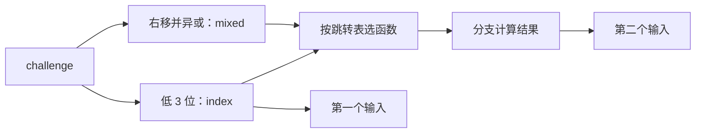


## 第 4 关：

`phase_04` 只检查一个数。它调用 `p4_walk` 时传入 `target=challenge&0x7f`、范围 `[0,127]`，以及 `salt=(uint32_t)(challenge>>7)^(uint32_t)(challenge>>32)`。我先看开头的 `sub`、`shr`、`add`，确定每层取的是 `mid=low+((high-low)>>1)`；再看 `jb` 才明白左右两个递归分支如何缩小范围。

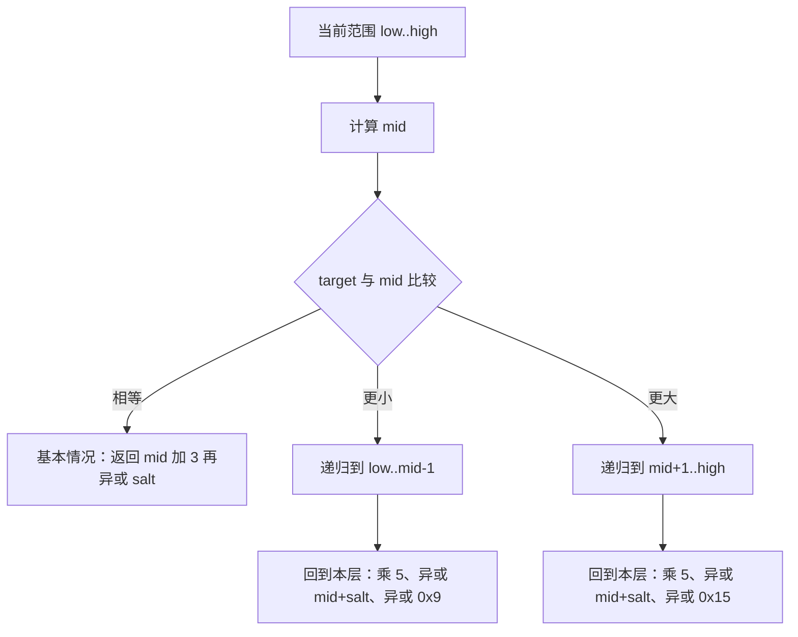

最初我以为找到 `target` 时的值就是最终答案，但 `call p4_walk` 后还有 `lea (%rax,%rax,4)` 和两次异或。并且要特别注意的是每一层都要加工子调用的返回值，而并不是直接返回函数的返回值。

```text
target == mid：返回 (mid + 3) ^ salt
target <  mid：child = walk(target, low, mid - 1, salt)
               返回 ((5 × child) ^ (mid + salt)) ^ 0x9
target >  mid：child = walk(target, mid + 1, high, salt)
               返回 ((5 × child) ^ (mid + salt)) ^ 0x15
```

## 第 5 关：先辨别地址，再遍历节点

`p5_traverse` 通过 `mov 0x405b20(,%rax,8),%rdx` 选起点，再通过 `mov (%rdx),%rdx` 沿链走。我一开始没有看出 `%rdx` 与 `(%rdx)` 的区别：前者是当前节点地址，后者是地址指向的内容。

GDB 的只读输出表明起点表有 8 项，节点区有 12 个节点。每个节点占 16 字节：偏移 `+0` 为 `next` 指针，`+8` 为 32 位 `value`，`+12` 为 32 位 `mask`。例如地址 `0x405b70` 的节点指向 `0x405bc0`，其 `value=0x1a`、`mask=0x1d59`。实现时我将这些固定地址转换成数组编号，以 `next` 字段记录链接。

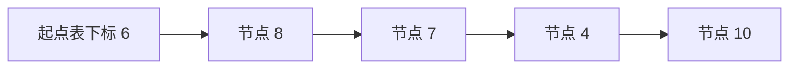

上图是一个遍历示例，实际起点由 `challenge&7` 决定。程序**先处理起点**，然后由 `(challenge>>3)&3` 决定额外走 0～3 步；即使节点还有 `next`，走够步数也会停。第一个结果起始于 `(uint32_t)(challenge>>6)`，异或高 32 位、起点的 `mask`、`0x3491`，再加起点 `value`。之后每到一个新节点，按汇编顺序更新：

```c
node_index = nodes[node_index].next;
result ^= nodes[node_index].mask;
last_value = nodes[node_index].value;
result += last_value;
```

`result` 是函数返回值，也就是第一个输入；`last_value` 会不断覆盖，最终成为第二个输入。这里的 `next=-1` 只是数组里表示链尾的方式，并非该循环的停止条件。

## 第 6 关：同一张函数表调用两次

`p6_dispatch` 有两条间接调用：`call *0x405dc0(,%rax,8)` 和 `call *0x405dc0(%rbx)`。第一次的下标是 `challenge&7`；第二次之前的 `and $0x38,%ebx` 保留第 3～5 位，得到的是经过计算后的位置偏移量，换成 C 数组下标就是 `(challenge>>3)&7`。

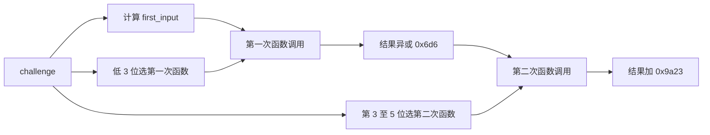

读取表项后，八个下标依次对应 `p6_op_0、4、0、5、3、2、1、2`。第一次函数的输入是 `(uint32_t)(challenge>>6)^(uint32_t)(challenge>>32)`；第二次接收第一次返回值异或 `0x6d6` 后的结果，最后再加 `0x9a23`。分析小函数时需要区分 `shr` 与 `rol`、`ror`：后两者会把移出去的位绕回另一端。实现中使用 `uint32_t` 左右移和按位或，还原了 32 位循环移位。

## 隐藏关：先看文本位置，再算三个数

隐藏关与前六关最大的不同是口令不只是整数。`secret_gate` 先检查整行长度并复制文本。复制缓冲区从 `rbp-0xd0` 开始，`cmpl $0x4e45504f,-0xb0(%rbp)` 则检查距起点 `0x20`（32）字节的位置。小端序下这四字节是 `OPEN`。随后 `lea -0xac(%rbp),%rdi` 把第 36 字节开始的文本交给 `secret_phase`；后者要求那里恰好有三个无符号整数。因此我用 32 个 `A` 作占位，后面接 `OPEN` 和三个十进制数。`A` 是自选占位字符，不是汇编要求的特定前缀。

`context` 根据前六关的输出传入 `solve_secret`。`secret_phase` 先比较第一个数与 `context&3`，再将 `challenge`、`context` 的高低 32 位分别异或。`secret_mix` 中的 `ror $1,%eax` 是 32 位循环右移一位，随后异或 `0x29af`。把中间量分开命名后，后两项关系比较清晰： 

注：此处命名的变量与代码中命名的不同。

```c
uint32_t first = (uint32_t)(context & 3u);
uint32_t P = (uint32_t)(challenge >> 32) ^ (uint32_t)challenge;
uint32_t Q = (uint32_t)(context >> 32) ^ (uint32_t)context;
uint32_t R = first * 0xefdeu ^ (uint32_t)(context >> 16);

uint32_t mixed = P ^ Q;
uint32_t second = ((mixed >> 1) | (mixed << 31)) ^ 0x29afu ^ R;
uint32_t third = second ^ (Q + first + 0xc671u + (P >> 1));
```

三个数算完后用 `snprintf` 将整行口令写入 `out`，并检查返回长度是否小于 `cap`；驱动负责把 `out` 打印出来。隐藏关的成功返回值是 `0`，与炸弹内部判定函数的布尔返回值不是同一个接口。

## 验证记录与截图

仓库 `tests/public.json` 的公开 seed 是 `0、1、7、42、99、123、2026、65535、987654321、18446744073709551615`。我选用不在列表中的 **43** 作为报告中的非公开 seed；以下每行补入实际运行输出和截图。

| 关卡 | 非公开 seed |  截图 |
| --- | ---: | --- |
| 第 1 关 | 43 | 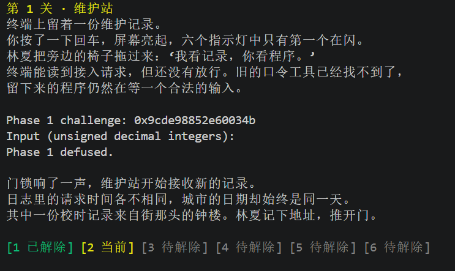 |
| 第 2 关 | 43 |  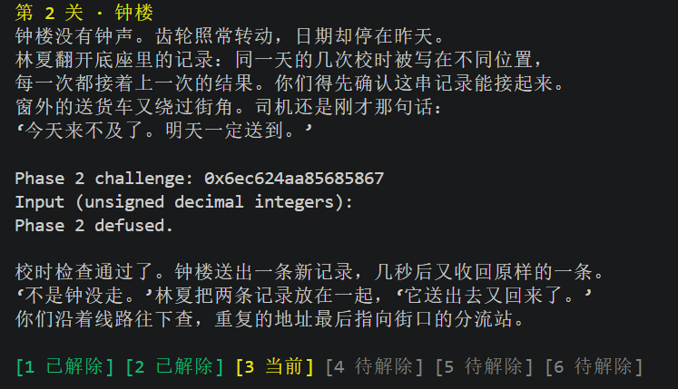 |
| 第 3 关 | 43 |  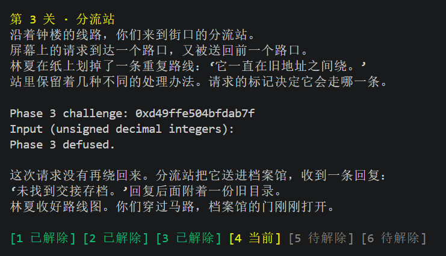 |
| 第 4 关 | 43 |  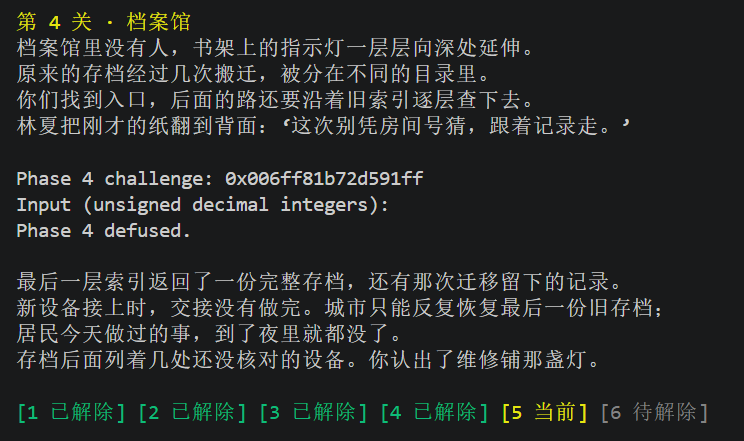 |
| 第 5 关 | 43 |  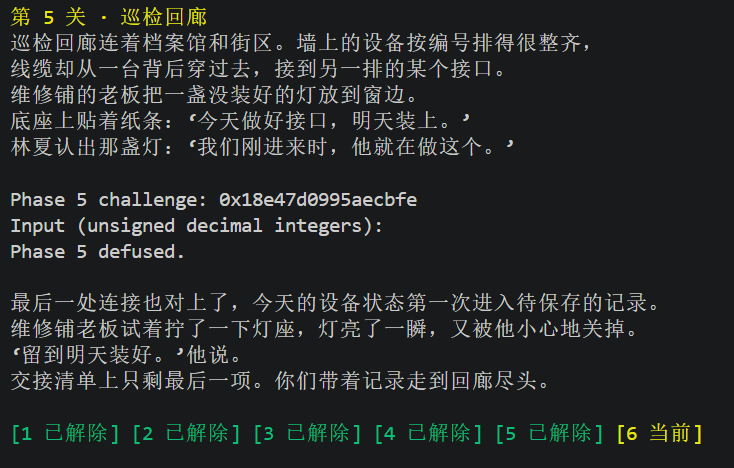 |
| 第 6 关 | 43 |  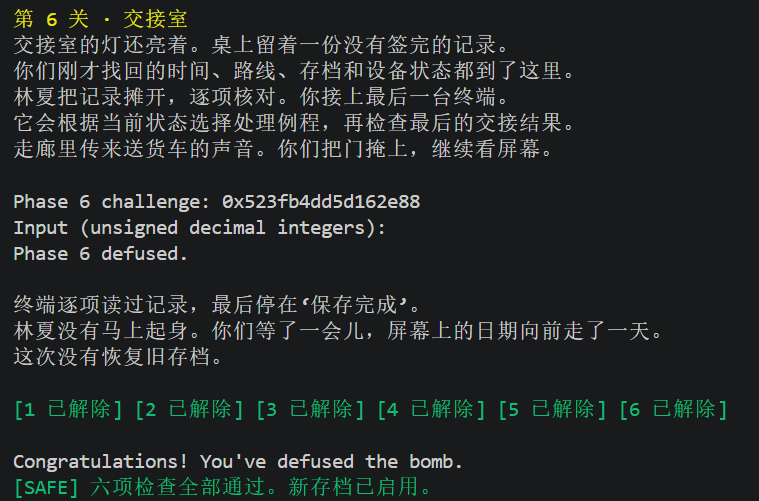 |
| 隐藏关 | 43 |  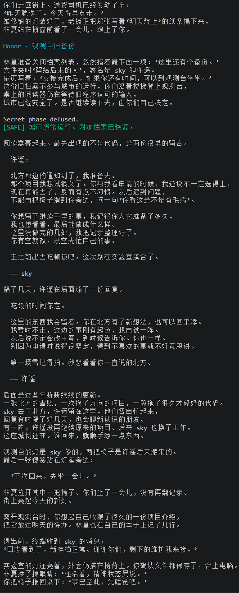 |


公开测试:本人实际运行的汇总截图补如下：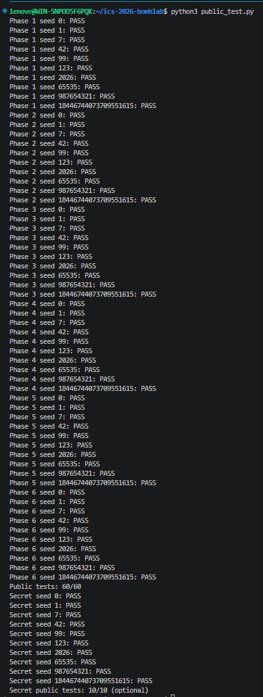。

## 资料与 AI 辅助说明

参考了本仓库 `README.md`、个人炸弹的反汇编与 GDB 只读观察结果，以及[课程 BombLab 教程](https://ics-26fall-fdu.github.io/labs/lab2-bomb-lab/)中的调试方法。使用 Codex 辅助理解汇编和调用约定、核对已经提出的计算式、定位编译及公开测试中的错误；它还协助整理了第 5 关的固定节点数据，提供第 6 关小函数和隐藏关文本输出的代码示例，并根据讨论记录起草本报告，然后由本人进行补充修正。
